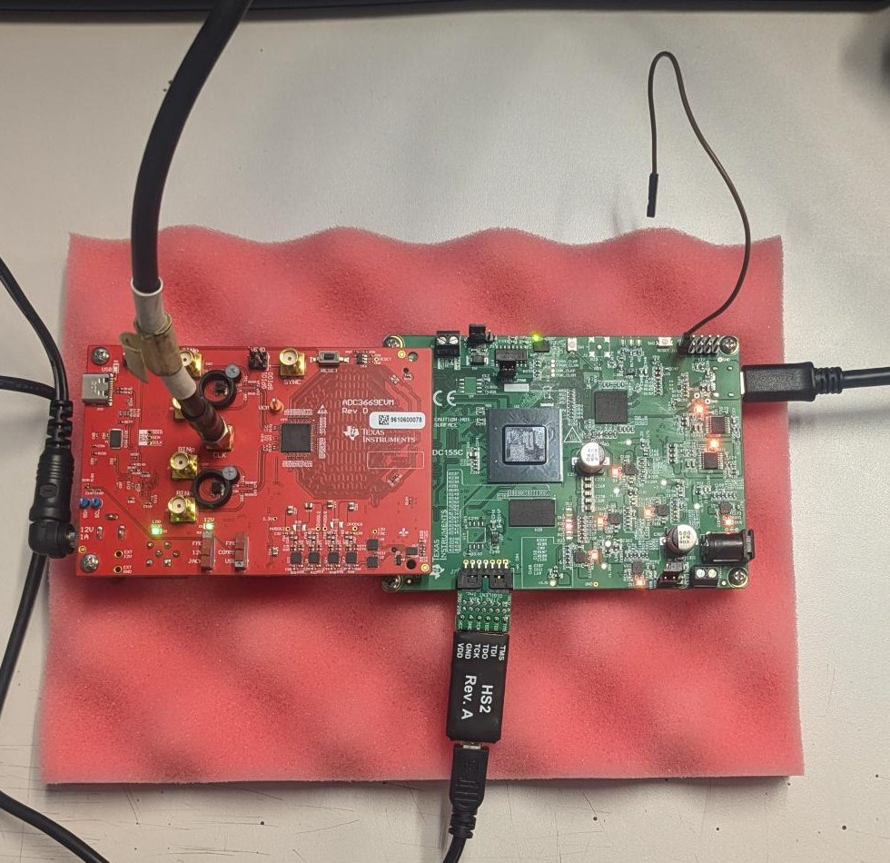
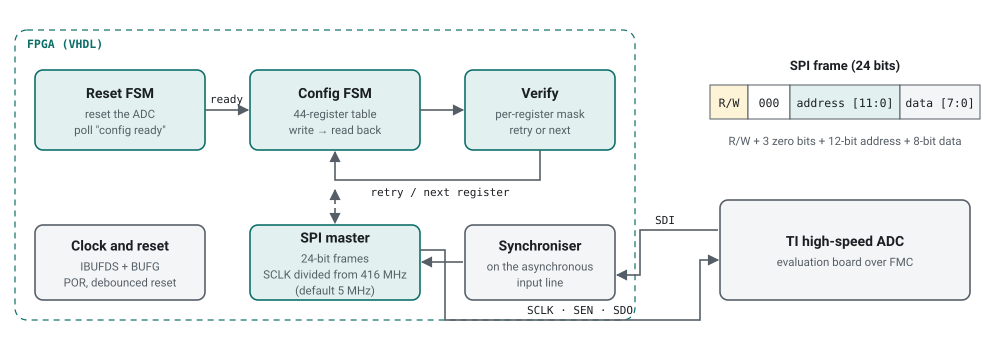
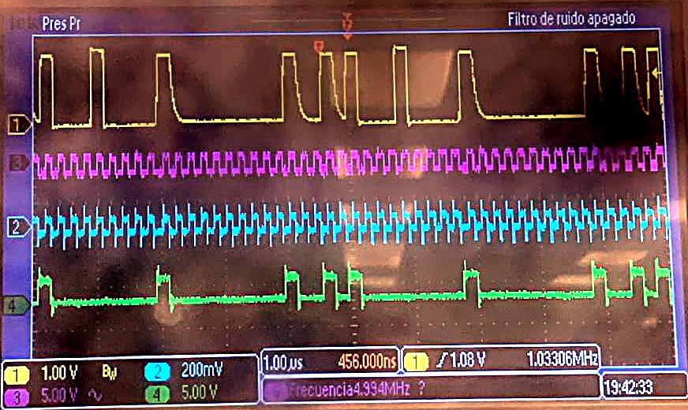

## Overview

Before the down-conversion chain can process anything, the high-speed ADC must be
configured. This separate Vivado project brings the ADC up from the FPGA: it resets
the converter, waits until it is ready, and loads its configuration over SPI, checking
every register.

Hardware: TI TSWDC155EVM (Artix-7 XC7A200T-FBG484) connected to a TI ADC evaluation
board over FMC. The ADC clock comes from an RF signal generator through an SMA cable.

## My role

I wrote the SPI master and both control state machines in VHDL, and debugged the
link on the board.

## Design

- **Reset state machine.** Resets the ADC and polls its "configuration ready" bit.
- **Configuration state machine.** Walks through a table of 44 configuration registers.
  For each one it writes the value, reads it back, compares the result through a
  per-register verification mask, and retries if the check fails.
- **SPI master.** 24-bit frames: R/W bit, 3 zero bits, 12-bit address, 8-bit data.
  SCLK is divided down from the 416 MHz system clock (5 MHz by default).
- **Robustness details.** A synchroniser on the asynchronous input line, a debounced
  manual reset, a power-on reset, and a differential clock input (IBUFDS + BUFG).

The per-register masks define which bits of each register must read back exactly as
written.

## Testing

I tested each module with its own VHDL testbench first, then on the board with two
tools together: the Vivado Integrated Logic Analyzer (ILA) inside the FPGA, and an
oscilloscope on the SPI lines.

*SPI traffic on the oscilloscope at 1 µs/div. The purple trace is SCLK; the readout shows
4.994 MHz for the 5 MHz setting. (Photo of the screen, contrast and sharpness enhanced.)*

## Lessons learned

- A read-back check with retries turns "the ADC does not work" into "register N failed",
  which is much faster to debug.
- Every signal that comes from outside the clock domain needs a synchroniser, even a
  slow SPI data line.
