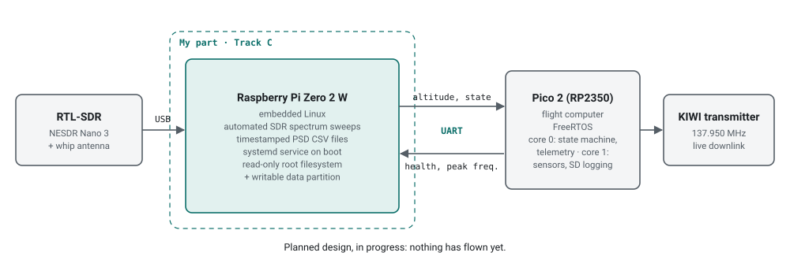

## Overview

AstreLoon is a student association in Toulouse, part of the CNES / Planète Sciences
student balloon programme. Our team of 12 is building a payload of at most 1.8 kg, in a
styrofoam nacelle, that will measure against altitude:

- the temperature and pressure profile (the mandatory meteorological experiment),
- UV-A, UV-B and UV-C,
- cosmic radiation with a Geiger counter, to find the Pfotzer maximum,
- single event upsets (bit flips) in SRAM, compared with the Geiger count,
- the radio spectrum,
- and two cameras: the horizon curvature and the colour gradient of the sky.

Live telemetry goes down through the KIWI transmitter of Planète Sciences / CNES at
137.950 MHz.

**This project is in progress. Nothing has flown yet**, and the design below is the
current plan.

## My role: Track C, RF co-processor

The flight software is split in three tracks. Tracks A and B run on the two cores of the
Raspberry Pi Pico 2 flight computer (state machine and telemetry; sensors and logging).
I am responsible for **Track C: the RF co-processor software on embedded Linux**, on a
Raspberry Pi Zero 2 W.

What the software must do:

- **Automated spectrum sweeps** with an RTL-SDR (Nooelec NESDR Nano 3, whip antenna),
  headless, for example over 88–108 MHz (FM), 118–137 MHz (aviation), 433 MHz (ISM) and
  868 MHz (LoRa), saving timestamped power-spectral-density CSV files.
- **Start on boot** as a systemd service, with a **read-only root filesystem** so a power
  cut cannot corrupt Linux.
- **UART bridge to the Pico 2:** receive the altitude and mission state to tag every
  sweep, and send back a short health and peak-frequency summary for the live downlink.

## Challenges already identified

| Problem | Why it matters | Current direction |
| --- | --- | --- |
| Power | The Saft LS14500 primary cells are rated 50 mA continuous per cell (250 mA pulses). The Pi Zero 2 W and the RTL-SDR draw several hundred mA at 5 V, more in the cold. | Raised with the avionics team. |
| RF coexistence | The KIWI transmitter at 137.950 MHz sits centimetres from the SDR and could saturate it. | Antenna placement, shielding, notch filter. |
| Read-only root vs data | Data must be written, but the root filesystem is read-only. | Separate writable data partition, periodic fsync and file rotation. |
| Comparable measurements | Power levels must be comparable across altitude. | Fixed SDR gain, no AGC. |
| Time | The Pi has no real-time clock. | Timestamps come from the Pico. |
| Power and self-interference | Wi-Fi and Bluetooth are not needed in flight. | Disable both. |

## Project log

This page is a living log. New entries go at the top.

### November 2026: joined the team

- Joined AstreLoon and took Track C (RF co-processor).
- Listed the first technical problems above and raised the power budget issue with the
  avionics team.
