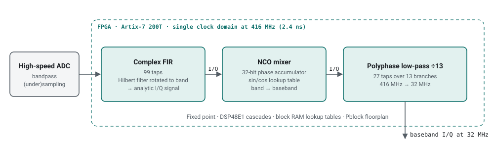
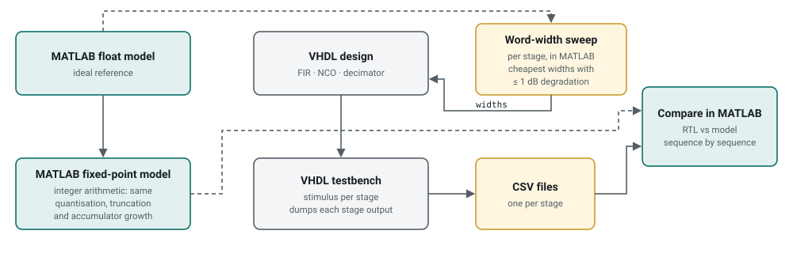

## Overview

During my internship in the firmware team of Indra's Air Defence division, I took a
fixed-point digital down-conversion (DDC) chain that a senior engineer had prototyped
on an Intel Cyclone IV, and moved it to a Xilinx Artix-7 200T. The goal was not a simple
port: the chain had to run at **416 MHz in a single clock domain**, which is a 2.4 ns
period for every register-to-register path.

The input is a bandpass signal that the ADC samples below the Nyquist rate of the
carrier (bandpass undersampling). The chain turns it into a complex baseband signal
at a lower rate.

## My role

- Ported the Cyclone IV (Quartus) prototype to the Artix-7 in VHDL.
- Re-architected the chain so it closes timing at 416 MHz.
- Built the fixed-point MATLAB reference model and the verification flow.
- Chose the word width of each stage with a MATLAB sweep.

The original Cyclone IV prototype was a senior engineer's work. The port, the
re-architecture for 416 MHz and the verification were mine.

## Architecture

| Stage | What it does | Implementation |
| --- | --- | --- |
| Complex FIR | Hilbert filter rotated to the band of interest. Produces the analytic I/Q signal. | 99 taps |
| NCO mixer | Moves the band of interest to baseband. | 32-bit phase accumulator + sin/cos lookup table |
| Polyphase low-pass | Filters and decimates by 13, from 416 MHz to 32 MHz. | 27 taps split across 13 branches |

A correlator/detector stage existed in an earlier version and was dropped from the
final design. The final design (FIR + NCO + polyphase decimator) closed timing at 416 MHz.

The design is fully parameterised. Filter coefficients are written as real values and
quantised at elaboration time, so changing a word width does not require new coefficient
files. VHDL assertions reject any word width that does not fit a single DSP48E1 slice
(25 × 18 multiplier, 25-bit data port), so a bad parameter fails at synthesis instead of
silently producing a slower design.

## Timing closure

At 2.4 ns there is very little room for logic between two registers. These are the
changes that made the design close:

1. **Hand-instantiated DSP48E1 cascades.** Vivado's inference left the filter delay line
   in fabric (normal flip-flops and routing). I instantiated the DSP48E1 primitives
   by hand and cascaded them, so the delay line stays inside the DSP slices.
2. **Lookup tables in registered block RAM.** Lookup tables moved into block RAM
   with registered outputs.
3. **Re-pipelining critical paths.** I added pipeline stages where the timing report
   showed long paths.
4. **Floorplanning with Pblocks.** Constraining the placement of each stage kept
   related logic close together and reduced routing delay.

Earlier runs failed timing; the iterations between those runs and the final one are
the most useful part of this project for me.

## Verification

- I first wrote a floating-point MATLAB model of the chain, then a fixed-point model that
  uses integer arithmetic with the same quantisation, truncation and accumulator growth
  as the hardware.
- VHDL testbenches dump the output of each stage to a CSV file. MATLAB reads the files
  and compares each sequence with the model.
- The RTL outputs matched the fixed-point model closely, though not bit for bit.
- I also used MATLAB to sweep the word width of each stage and choose the cheapest
  combination that keeps the degradation below 1 dB.

## Lessons learned

- **Read the synthesis result, not only the timing summary.** The main timing problem
  came from what inference built (a delay line in fabric), not from the logic I wrote.
- **A model is only useful if it is wrong in the same way as the hardware.** The
  floating-point model was not enough; the fixed-point model with the same truncation
  was what made the stage-by-stage comparison meaningful.
- **Make bad parameters fail early.** Elaboration-time assertions saved time every time
  a word width changed.

## Tools

VHDL · Xilinx Vivado 2021.1 (synthesis, implementation, timing analysis, floorplanning,
ILA) · Intel Quartus (source prototype) · MATLAB · oscilloscope.
