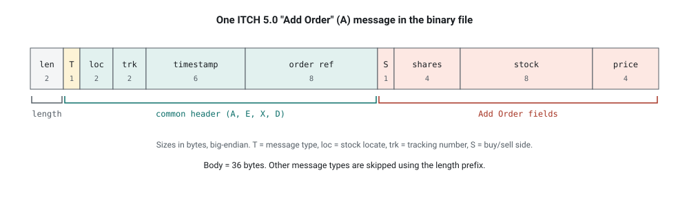

## Overview

Trading firms receive exchange data as a stream of small binary messages, and the
first step in a trading system is to decode them as fast as possible. FPGA teams do this
in hardware, where the latency of each message can be counted in clock cycles.

This project builds that first stage for NASDAQ's full order book feed,
TotalView-ITCH 5.0. It starts with a C++ reference parser, which also produces the test
vectors, and continues with a SystemVerilog parser that must give the same output for every
message.

**This project is in progress.** Step 1 of 6 is done; the SystemVerilog parser is next.

## Roadmap

| # | Step | Status |
| --- | --- | --- |
| 1 | C++ parser for Add Order (A), Order Executed (E), Order Cancel (X) and Order Delete (D), and golden test vectors for one stock | Done |
| 2 | SystemVerilog parser: a byte stream in (8-bit data + valid), decoded fields and a valid pulse out, simulated with Verilator | Next |
| 3 | cocotb testbench that streams the real messages and compares every field with the C++ output | Planned |
| 4 | Documentation: block diagram, test instructions, clock cycles per message | Planned |
| 5 | Port the SystemVerilog parser to VHDL, with the same ports and the same testbench | Planned |
| 6 | Extensions: top-of-book tracker, Vivado synthesis (Fmax, resources) from a scripted build, an FPGA board, Ethernet/UDP input | Later |

## How the format works



Each message starts with a 2-byte big-endian length, followed by a body whose first byte
is the message type. All fields are fixed-width and big-endian, and the timestamp is
6 bytes (nanoseconds since midnight).

## Step 1: the C++ reference parser

### Design

- **Two layers.** The main loop reads the length prefix and then the whole message into a
  buffer. The decoder only sees that buffer, so it can be reused later for memory-mapped
  input or latency benchmarks.
- **The specification is the only source for offsets.** Every field offset and message
  length is a named constant in one header, checked against the ITCH 5.0 specification.
  The SystemVerilog will use the same names.
- **Validate before reading.** The decoder checks the message type and its exact length
  before it reads any field, so it never reads past the end of a message. Unknown types
  and wrong lengths are rejected.
- **Explicit big-endian loads** with small shift-based helpers, never by casting the buffer
  onto a struct, so there are no alignment or endianness assumptions.
- **One flat output record** with the fields of all four message types, laid out like the
  future HDL output ports. Prices are integers with 4 implied decimals; there is no
  floating point.

```cpp
// 6 bytes, big-endian (the ITCH timestamp)
inline uint64_t read_be48(const uint8_t* p) {
    return (uint64_t(p[0]) << 40) | (uint64_t(p[1]) << 32) | (uint64_t(p[2]) << 24) |
           (uint64_t(p[3]) << 16) | (uint64_t(p[4]) << 8)  |  uint64_t(p[5]);
}
```

### Testing on real data

I ran the parser on a 100 MB slice of NASDAQ's public sample file from 30 October 2019:

| Check | Result |
| --- | --- |
| A, E, X and D messages decoded | 3,061,774 |
| Other message types skipped by their length | 374,300 |
| Last message cut by the slice | Detected and reported cleanly |
| AddressSanitizer and UndefinedBehaviorSanitizer | Clean |
| One message of each type checked by hand against a hex dump | Matches |

### Golden test vectors

To test the hardware, I extracted every order message for one stock (TOT) into two files:
the raw messages in their original framing, which will be the testbench input, and the
expected decoded fields, one row per message. That is 119,513 messages: 45,820 Add,
45,746 Delete, 27,924 Cancel and 23 Executed (the slice is before the market opens, so
executions are rare). Feeding the raw file back into the parser gives the same 119,513
messages with none skipped.

## How I use AI on this project

The project is a learning exercise, and I need to be able to explain every line. I use an
AI assistant as a reviewer and mentor: it explains design choices and C++ features, and
reviews my code for the mistakes an interviewer would catch. I write the parsing logic and
the hardware logic myself, and every result is checked against real data and the
specification.

## Project log

New entries go at the top.

### November 2026

- Repository renamed to `itch-fpga-feed-handler` and roadmap written.
- Step 1 finished: decoder, binary and CSV output of the golden test vectors for TOT,
  sanitizer runs and hand checks against hex dumps.
- Added the ITCH 5.0 specification to the repository and set up the project.
- Wrote the big-endian helpers and the message structure; decoding of Add, Execute,
  Cancel and Delete running.
