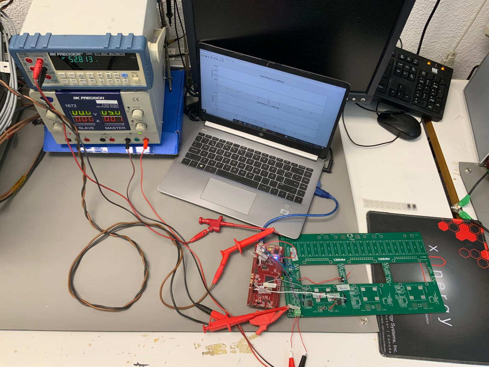
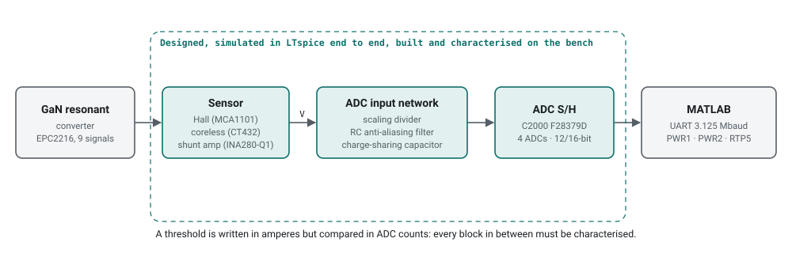
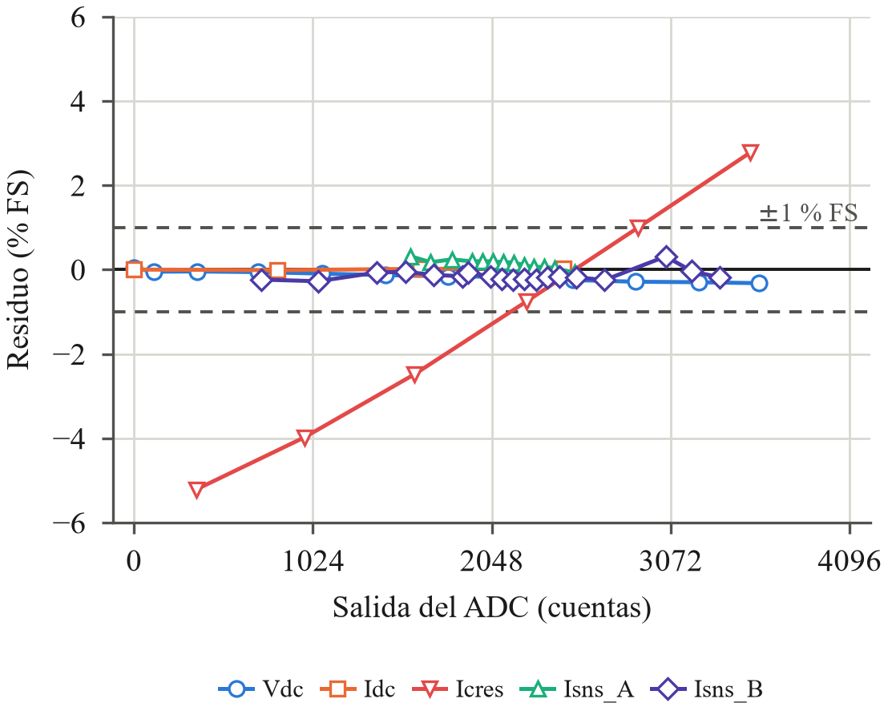
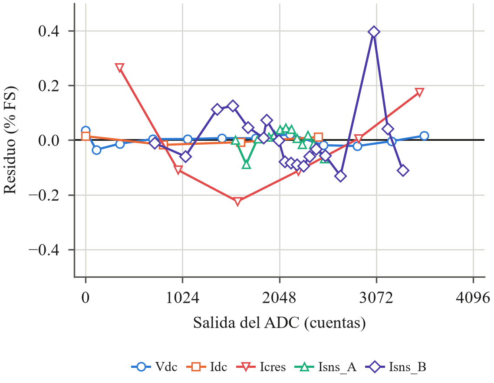
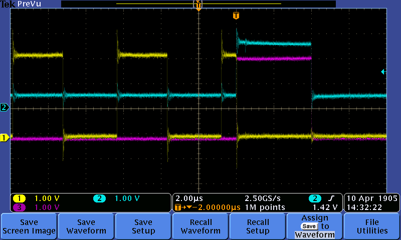
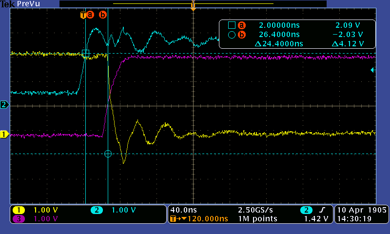

## Overview

**WI-UFO** is a research project at the Centre for Industrial Electronics (CEIMM,
ETSII-UPM), started in 2024. It develops one wireless charging station that can charge,
in both directions over a resonant inductive link, a fleet of autonomous vehicles with
very different power needs: around 2 kW for a drone and 10 kW for a rover. The
reference scenario is NASA's Mars 2020 mission (Perseverance and Ingenuity), where each
vehicle carries its own power generation. WI-UFO studies a shared station instead.
It is a university research project; it is not run by NASA or ESA.

The converter is a resonant inverter with GaN transistors (EPC2216), LM5114 gate
drivers, ISO7710 digital isolation and Schottky rectification. It is exposed to
overcurrent, short circuits and sudden decoupling when the coils are misaligned, and
the thermal margins of GaN devices leave very little time to clear a fault.

> A protection is no better than its sensor.

A protection threshold is written in amperes but compared in ADC counts. Between the two
there is a whole measurement chain, and it had not been characterised. My thesis studies,
designs and experimentally characterises that chain for the 9 signals of the converter,
from sensor to digital code. It does not close the protection loop; it builds the
measurement basis that the protection needs.

**Everything on this page was built and tested on real hardware, not only simulated.**

## My role

The converter belongs to the WI-UFO team. The measurement chain was my thesis work:
simulation, sizing of the ADC input network, acquisition firmware, bench
characterisation and the two protection prototypes.

## Hardware: the measurement chain

| Signal | Sensor | Count |
| --- | --- | --- |
| Isns_A, differential branch current | Allegro CT432 (coreless) | 3 |
| Isns_B, single-ended branch current | MCA1101 (Hall effect) | 3 |
| Vdc, bus voltage | resistive divider | 1 |
| Idc, bus current | INA280-Q1 shunt amplifier | 1 |
| Icres, resonant current | — | 1 |

The work had four stages:

1. **Simulation.** The complete chain in LTspice (converter → sensor → conditioning → ADC),
   including a model of the ADC sample-and-hold. System-level simulation in PLECS.
2. **Sizing the ADC input network.** Scaling divider, RC anti-aliasing filter and
   charge-sharing capacitor. I drew design-space nomograms (Rs, Cs) in MATLAB with
   constant-bandwidth and constant-settling-time curves.
3. **Acquisition firmware** in C on a TI TMS320F28379D (LaunchXL-F28379D, 200 MHz C2000),
   in Code Composer Studio.
4. **Bench characterisation**, signal by signal, in the lab.

## Firmware

All 9 signals are acquired simultaneously across the 4 independent ADCs. Conversions are
hardware-triggered by ePWM modules, and 3 prioritised interrupts handle 3 time domains,
for about 15 % CPU load.

The key constraint: one ADC has a single conversion mode, so single-ended and differential
inputs cannot be mixed on the same ADC. The final split:

| ADC | Mode | Signals | Rate |
| --- | --- | --- | --- |
| A, B, C | 12-bit single-ended | Isns_B (high priority) | 180 kHz |
| A, B, C | 12-bit single-ended | Vdc, Idc, Icres | 50 kHz |
| D | 16-bit differential | Isns_A, round-robin over 3 phase-locked slots (EPWM8/EPWM9) | 60 kHz frame |

- Acquisition windows differ: 15 SYSCLK cycles for 12-bit single-ended, about 64 for
  16-bit differential.
- Trade-offs checked by test: up to 300 ns of skew between bus signals, and staggered
  sampling of the three Isns_A channels.
- **UART streaming to MATLAB at 3.125 Mbaud.** This rate has an exact clock divisor;
  460800 and 921600 baud were rejected because their error was above 3 %.
- **Custom protocols:** PWR1 (one channel), PWR2 (N channels, channel index in the top
  4 bits of each word), and RTP5 (real-time streaming with negotiation: MATLAB proposes
  a signal mask, and the MCU accepts or rejects it based on the UART bandwidth budget of
  about 150 kHz).

## Testing and results

| Signal | Bench test | Result |
| --- | --- | --- |
| Isns_A | −40 A to +40 A sweep, real current through the sensor | 34.54 mV/A |
| Isns_B | −40 A to +40 A sweep, real current through the sensor | 40.10 mV/A |
| Vdc | 0 to 99.664 V sweep | 35.882 counts/V |
| Idc | emulated shunt-amplifier output, 0–3 V | — |
| Icres | amplitude (0–20 Vpp) × frequency (DC to 120 kHz) sweep | real frequency response of the chain |

- **Without calibration**, 4 of the 5 chains stay within 1 % of full scale (Icres: 5.2 %).
- **With a two-parameter calibration** (gain and offset), all five chains are below 0.4 %.
- **The ADC resolution was not the limit.** 1 % of full scale needs 6 to 8 bits, and the
  ADCs have 12 or 16. The input network was the limit: for the two AC chains, no
  charge-sharing capacitor satisfies both the bandwidth and the acquisition time.

*Residuals of the five chains in % of full scale (4096 counts): first against the design line
(uncalibrated), then against the measured line (calibrated). Axis labels in Spanish.*

- **Conclusion:** amplitude thresholds can now be set with known accuracy. Reaction time
  cannot yet: gain, offset and noise are measured, but bandwidth and delay need a dynamic
  test campaign, which I proposed as future work.

## Protection prototypes

During the thesis I also built two working firmware prototypes for the next step.

### Hardware-only overcurrent trip: 24.4 ns

A CMPSS window comparator (two DAC thresholds) feeds the ePWM X-BAR, then Digital Compare,
then the Trip Zone, which forces both PWM outputs off. There is no CPU in the path, so the
protection still works if the firmware hangs. **I measured 24.4 ns on the oscilloscope**
from threshold crossing to PWM shutdown.

The non-obvious detail: Digital Compare events are split per output. The trip must be
routed to both the A and B paths. Otherwise one switch of the half-bridge keeps
conducting during the fault, which is worse than no protection at all.

*Trip test on one branch current, 2 µs/div. Yellow: PWM output. Blue: stimulus on the
monitored input. Purple: comparator output, which goes high when the signal leaves the
allowed window.*

*Same test at 40 ns/div. The cursors measure 24.4 ns from threshold crossing to PWM shutdown.*

### Peak capture of a 90 kHz sine without fast sampling

The CMPSS detects the zero crossing and resynchronises the ePWM counter in hardware.
The ePWM then triggers the ADC at T/4 and 3T/4, which are the peaks. The counter is
resynchronised every cycle, again with no CPU in the loop.

## Design decisions and lessons learned

- **Convert to volts before comparing.** The ADC uses VREFHI as its reference while the
  CMPSS DAC uses VDDA = 3.3 V, so ADC codes and DAC values are not directly comparable.
- **Read the board errata.** On the Rev 1.1 LaunchPad, ADCINA2 is shorted to VREFHIB and
  the silkscreen on J3/J7 is wrong. I had to handle both.
- **Characterise before you protect.** Knowing gain, offset and error per channel is what
  makes a threshold in amperes mean something in ADC counts.

## Tools

C · TI C2000 (Code Composer Studio, ePWM, CMPSS, ADC, X-BAR, Trip Zone) · LTspice ·
PLECS · MATLAB · oscilloscope · signal generator.
